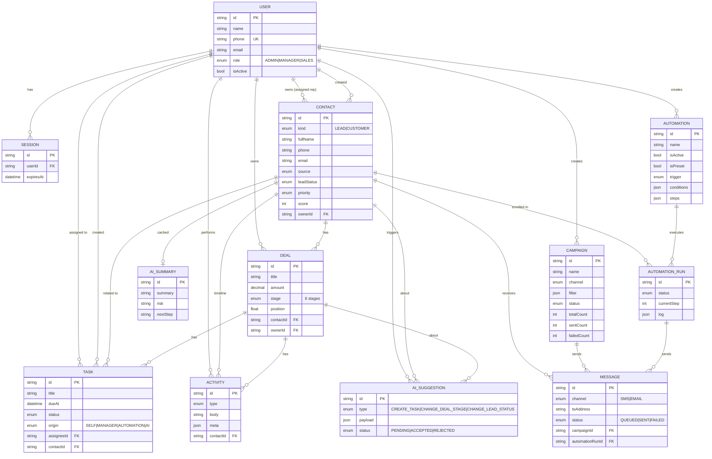

# ERD — CRM

Paste the diagram block into https://mermaid.live to view/export it as an image.

## Design decisions (for the README)

1. **One `Contact` table** for leads and customers (`kind`). Conversion flips `kind`; history stays.
2. **`Activity` is the timeline** and the input for AI summaries and smart notes.
3. **OTP lives in Redis**, not in the database.
4. **Automations store steps as JSON**; the visual builder just edits that JSON.
5. **AI never writes directly**: it creates `AiSuggestion` rows (PENDING); applying happens only after user approval.
6. **Messages are always created as QUEUED** and sent by the BullMQ worker, so the UI never blocks on a provider.
